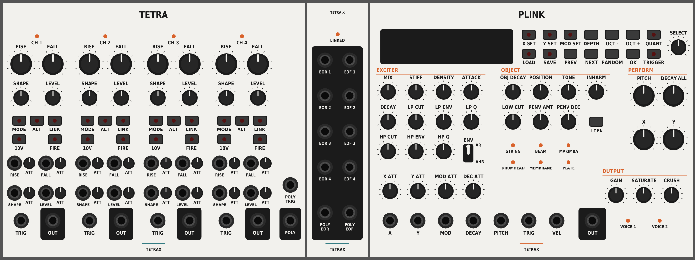

# Tetrax for VCV Rack

Tetrax is a VCV Rack 2 plugin with three modules:

- **TETRA**, a four-channel function generator. Each channel is an envelope, a cycling function, a burst generator or an LFO, and the channels can trigger each other in a ring.
- **TETRA X**, an expander that adds end-of-rise and end-of-fall gates for each TETRA channel.
- **PLINK**, a two-voice percussion synthesizer. A mallet and a noise burst strike a modelled string, bar, drum, membrane or plate.

TETRA and TETRA X are inspired by the Intellijel Quadrax and Qx. PLINK is inspired by the Intellijel Plonk, which Intellijel made with Applied Acoustics Systems. These are a living maker's current products. Tetrax is an independent re-imagining built from the public manuals, with its own names, panels and sounds. PLINK's physical models are our own modal synthesis, not AAS's, so it is close in character but is not a clone.

---

## TETRA

Four identical channels, numbered 1 to 4 from the left. Each channel has one output and runs one **mode**.

### Controls (each channel)

| Control | What it does |
|---|---|
| **CH light** | Shows the output. Green for positive, red for negative (blue and orange with the colour-blind palette in the right-click menu) |
| **RISE**, **FALL**, **SHAPE** | Their job depends on the mode (table below). The tooltip always shows the current job and value |
| **LEVEL** | Output level, 0 to 100%. Right-click "Stepped level" gives the hardware's 20% steps |
| **MODE** | Steps through the modes. Its light shows which: white AD, red AHR, green CYCLE, yellow BURST, magenta LFO |
| **ALT** | Switches the current mode to its alternate version (yellow light on). Each mode remembers its own ALT setting |
| **LINK** | Lets the channel to the left fire this one. Off (dark), red TRIG, green end of rise, yellow end of fall. Channel 1's left neighbour is channel 4, so the four make a ring |
| **10V** | Lit: the output goes 0 to 10 V. Dark: 0 to 5 V. LFOs are always ±5 V |
| **FIRE** | Fires the channel by hand. Its light flashes whenever the channel fires, from any source |
| **RISE, FALL, SHAPE, LEVEL CV** | CV for each control, with an **ATT** attenuverter beside each jack (fully clockwise by default). 5 V moves the control by its full travel, and CV can push RISE and FALL beyond the knob's range |
| **TRIG** | Trigger or gate in, or a clock in LFO mode |
| **OUT** | The channel's output |

**POLY TRIG** (right strip) feeds channel 1 of a polyphonic cable to channel 1's TRIG, channel 2 to channel 2, and so on. **POLY** outputs all four channels on one cable.

### What RISE, FALL and SHAPE do in each mode

| Mode | RISE | FALL | SHAPE |
|---|---|---|---|
| AD, AHR, CYCLE | Rise time | Fall time | Curve: log, linear at noon, exponential |
| BURST | Pulse rate | Burst length | Pulse shape and how the pulses rise or fade |
| LFO | Rate, or clock ratio | Morph | Wave shape |
| LFO + ALT (LFV) | Rate, or clock ratio | Variance | Slew |

Times run from about 0.05 ms at full left, through 50 ms at noon, to 20 s at full right. Rates run from 0.05 Hz (20 s per cycle) to about 3.3 kHz, so BURST and LFO can run at audio rate.

### The modes

- **AD.** A trigger runs the whole rise and fall. The gate length doesn't matter. A new trigger restarts the rise from wherever the output is.
- **AHR.** The output rises when the gate goes high, holds at the top while the gate stays high, and falls when the gate goes low. A gate shorter than the rise time falls before it reaches the top.
- **CYCLE.** Rises and falls over and over. One cycle lasts the rise time plus the fall time. A trigger restarts the rise.
- **BURST.** A trigger starts a burst of evenly spaced pulses that fills the burst length. SHAPE sets the pulse shape (square at the ends, smooth in between) and where the burst is loudest: at the start (full left), in the middle (noon) or at the end (full right). With TRIG unpatched the bursts repeat. Right-click "Burst retrigger" lets a trigger restart a running burst.
- **BURST + ALT.** The pulses morph from sawtooth (left) through triangle (noon) to ramp (right), all at full level.
- **ALT on AD, AHR and CYCLE.** Mirrored curves. Right of noon gives a fast-rising, fast-dropping "spiky" shape. Left of noon gives a rounded, "bell-like" shape.
- **LFO.** A ±5 V LFO. SHAPE sweeps sine, triangle, ramp up, square and ramp down. FALL (MORPH) skews the wave: it is the pulse width on the square, and it moves the peak on the triangle. With a clock at TRIG, RISE picks a ratio from /64 to ×64 (noon is 1:1). A clock edge resets the phase, so it stays locked.
- **LFV (LFO + ALT).** A random voltage that moves to a new value every cycle. FALL right of noon jumps anywhere around 0 V. Left of noon it wanders in small steps (a "drunk walk"). SHAPE left gives sharp corners. SHAPE right smooths them, which also makes the moves smaller.

### Linking

LINK lets the channel to the left fire this one, as well as this channel's own TRIG and FIRE:

- **TRIG (red)** passes the left channel's gate itself, so an AHR here holds for as long as the original gate.
- **End of rise (green)** fires when the left channel reaches its peak.
- **End of fall (yellow)** fires when the left channel finishes.

LFOs that are linked reset together. A reset into any linked channel also resets the channels before it in the chain.

---

## TETRA X

Place TETRA X **directly to the right** of TETRA. The LINKED light shows that it can see TETRA.

Each channel has an **EOR** (end of rise) and an **EOF** (end of fall) gate, at 0 or 10 V. **POLY EOR** and **POLY EOF** carry all four channels on one cable.

| Mode | EOR is high | EOF is high |
|---|---|---|
| AD | From the peak until the fall ends | Except during the fall |
| AHR | From the peak until the release ends | Except during the release |
| CYCLE | During the fall | Except during the fall |
| BURST | During the first half of each pulse | When no burst is running |
| LFO | During the second half of each cycle | During the first half of each cycle |
| LFV | While the voltage is moving down | While the voltage is moving up |

---

## PLINK

Each hit has two parts. An **exciter** (a mallet, a burst of filtered noise, or a mix of both) strikes an **object** (String, Beam, Marimba, Drumhead, Membrane or Plate). The object rings with up to 64 partials. Each partial has its own pitch, level and decay, and they come from the physics of that shape. Two voices let one hit ring on while the next one sounds.

Every sound setting has a knob, so it can be mapped and automated. The values run 0 to 127 (or −64 to +63) as on the hardware. Each tooltip also shows the real value, such as a time or a frequency.

### Display and buttons

The display shows the preset (`017 Marimba`, with a `*` once you change it), then the object, octave and X destination. Turn any knob to see its name and value for a moment.

| Button | What it does |
|---|---|
| **X SET**, **Y SET**, **MOD SET** | Pick what the X, Y or MOD input controls. Press, turn **SELECT** to scroll the list, and press again to finish |
| **DEPTH** | Steps the chosen input's depth through LOW, MED, HIGH and FULL (±16, ±32, ±64 or ±128 on the 0 to 127 scale for ±5 V). For Preset Step, DEPTH moves on to choosing preset A, then preset B. For Morph, it moves on to choosing the target preset |
| **OCT −**, **OCT +** | Octave of the sound (C3 is the default root, at PITCH noon and 0 V) |
| **QUANT** | PITCH knob in semitone steps (lit) or smooth over ±2 octaves |
| **LOAD** | Press, turn SELECT to preview presets (you hear each on the next hit), then press LOAD or OK to keep it. Any other button cancels |
| **SAVE** | Press, turn SELECT to pick a slot, press SAVE or OK to save there |
| **PREV**, **NEXT** | Load the previous or next preset |
| **RANDOM** | A random new sound (Rack's undo brings the old one back) |
| **TRIGGER** | Plays a hit |
| **TYPE** | Steps the object type. The six lights below show which |

### Exciter

| Knob | What it does |
|---|---|
| **MIX** | Mallet only (0) to noise only (127) |
| **STIFF** | Mallet hardness: soft and round (0) to hard and clicky (127) |
| **DENSITY** | Noise made of sparse clicks (low) up to continuous hiss (high). 50 to 100 suits bowed sounds and snares |
| **ATTACK**, **DECAY** | The noise envelope |
| **LP CUT**, **LP Q**, **HP CUT**, **HP Q** | Low-pass and high-pass filters on the noise. Together they make a band-pass |
| **LP ENV**, **HP ENV** | How far the noise envelope sweeps each filter, up or down |
| **ENV** switch | AR: the noise envelope runs by itself. AHR: it holds while TRIG is high, for bowed and blown sounds |

### Object

| Control | What it does |
|---|---|
| **OBJ DECAY** | How long the object rings |
| **POSITION** | Where it's struck, from the edge (0) to the middle (127). Striking the middle silences some partials. A string struck in the middle loses its even harmonics |
| **TONE** | Material. Low settings make high partials die fast, like wood, nylon or plastic. High settings let them ring, like metal or glass |
| **INHARM** | Squeezes the partials together (below 0) or spreads them apart (above 0) |
| **LOW CUT** | Removes the lowest partials, leaving a thinner, brighter sound |
| **PENV AMT**, **PENV DEC** | Pitch sweep at each hit: starts up to one octave above or below, and glides back over PENV DEC |
| **TYPE** | String, Beam (a plain bar), Marimba (a tuned bar), Drumhead (round drum), Membrane (rectangular, more clangy), Plate |

### Perform and output

| Control | What it does |
|---|---|
| **PITCH** | ±2 octaves around the octave's root |
| **DECAY ALL** | Scales both the object decay and the noise decay. Fully right is 100% |
| **X**, **Y** | Manual offsets for whatever X and Y control |
| **X ATT**, **Y ATT**, **MOD ATT**, **DEC ATT** | Attenuverters for the X, Y, MOD and DECAY inputs |
| **GAIN** | Output gain, −20 to +40 dB. It's stored with each preset |
| **SATURATE** | Asymmetric saturation, 0 to 60 dB of drive |
| **CRUSH** | Bit depth: off, then 10 bits down to 1 bit |

A limiter keeps the output below about ±9.5 V.

### Inputs

| Jack | What it does |
|---|---|
| **X**, **Y** | CV for the X and Y destinations (±5 V) |
| **MOD** | CV for the MOD destination, or a gate for MOD's special jobs (below) |
| **DECAY** | CV for DECAY ALL |
| **PITCH** | 1 V/oct. Read when a hit starts and while TRIG stays high, so a sequencer's pitch never smears into a ringing note |
| **TRIG** | Trigger or gate. Polyphonic when Voices is 4 or 8 |
| **VEL** | Velocity. It's set to 5 V when nothing is plugged in. Right-click picks one of three modes. **Accent** (default): a hit above 1.5 V is accented, and a lower one is 6 dB quieter and softer. **Dynamics**: hit strength follows the voltage. **Volume**: the voltage sets the output level |

### What X, Y and MOD can control

Any exciter or object setting, plus **R Pitch** (pitch modulation, up to ±24 semitones, which is fast enough for FM), **Saturation** and **Bitcrusher**. MOD has six extra jobs:

- **Choke Both / Choke Res / Choke Noise.** While a gate is high at MOD, the object, the noise or both die away within about 15 ms.
- **Preset Step.** At each hit, the MOD voltage picks a preset between A (0 V) and B (5 V). This is how kits work. Each voice keeps the preset it was struck with.
- **Randomize.** Each rising gate at MOD makes a new random sound.
- **Morph.** The MOD voltage blends the current sound (0 V) toward a target preset (5 V). The object type doesn't morph.

### Voices

With 2 voices (the default), a new hit goes to a free voice, or takes over the oldest one. The older sound keeps ringing with its settings frozen, so turning knobs only changes the newest hit. With 1 voice, a new hit cuts off the last one. The right-click menu also offers 4 or 8 voices. With 4 or 8 voices and a polyphonic TRIG cable, each channel plays its own voice with its own PITCH and VEL. **Poly out** sends each voice on its own channel.

### Presets

PLINK holds 128 presets, saved with the patch. The first 32 are factory sounds:

| Slots | Sounds |
|---|---|
| 1 to 4 | **Kit Wood** (kit), Kick Skin, Snare Wire, Hat Plate |
| 5 to 8 | **Kit Metal** (kit), Kick Beam, Clank, Tick |
| 9 to 12 | **Kit Hand** (kit), Conga, Clap Noise, Shaker |
| 13 to 16 | **Kit Glass** (kit), Glass Kick, Glass Hit, Shard |
| 17 to 22 | Marimba, Vibe Bar, Kalimba, Nylon Pluck, Steel String, Bowed String |
| 23 to 32 | Tom Low, Tom High, Gong, Bell, Cowbell-ish, Log Drum, Water Drop, Zap, Rain Plate, Wind Tube |

Loading a **kit** sets MOD to Preset Step over the three sounds that follow it. Send 0 V, 2.5 V or 5 V into MOD for the first, second or third sound. The right-click menu can load any preset by name, rename the current one, save to the current slot, return to the default sound, reset the bank to factory, and export or import the whole bank as a file.

---

## Patch recipes

Each recipe lists what you need. Everything outside Tetrax is in VCV's free library.

1. **Four-stage loop** (TETRA only). Set all four channels to AD and every LINK to end of fall (yellow), then press FIRE on channel 1. Each channel fires the next and channel 4 fires channel 1, so it runs by itself. Different RISE and FALL settings per channel give a slow, irregular four-part LFO. Mix the outputs, or send them to four different places.
2. **Ratchets** (TETRA + VCV VCA + a drum). Set channel 1 to BURST with RISE at about 30 Hz and FALL at about 150 ms. SHAPE full left makes the hits fade. Patch OUT to the VCA's CV and the drum through the VCA. Trigger it from your sequencer for rolls.
3. **A burst voice** (TETRA + VCV Scope or a mixer). Set BURST + ALT with RISE high, so the pulses are audio rate, and FALL long. Each trigger gives a buzzy tone with its own envelope. Patch a keyboard's pitch into RISE CV to play it.
4. **Clock-locked LFO family** (TETRA + a clock). Clock into TRIG 1. Set all four channels to LFO and LINK channels 2 to 4 to TRIG (red). Give each channel a different RISE ratio. You get four LFOs that stay locked to the clock and to each other.
5. **Drifting timbre** (TETRA + PLINK). Set TETRA channel 1 to LFO + ALT (LFV) with RISE slow and FALL left of noon. Patch OUT 1 into PLINK X (X = R Tone) and channel 2 the same way into Y (Y = R Position). Each hit lands on a slightly different material and strike point.
6. **Attack, punch and tail** (TETRA + TETRA X). Set channel 1 to AHR from a gate. Set channel 2 to AD with LINK = end of rise, so it fires at channel 1's peak. Set channel 3 to AD with LINK = end of fall. That gives three envelopes for three parts of one sound. TETRA X's EOF 3 tells you when the whole thing is done.
7. **One-module drum kit** (PLINK + VCV SEQ-3). Load preset 1, Kit Wood. Patch the sequencer's gate into TRIG and one CV row into MOD, set to 0 V (kick), 2.5 V (snare) or 5 V (hat) per step. Patch a second row into VEL for accents (above 1.5 V accents).
8. **Marimba melody** (PLINK + any sequencer). Load preset 17, Marimba. Patch pitch into PITCH and gates into TRIG. Turn on QUANT if you play the PITCH knob by hand. For a softer feel, set Velocity mode to Dynamics and feed it a random CV.
9. **Wood into glass** (PLINK + TETRA). Load Marimba. Set MOD SET to Morph, press DEPTH and pick Glass Hit (slot 15). Patch a slow TETRA LFV into MOD. Every hit lands somewhere between wood and glass.
10. **A new instrument every bar** (PLINK + VCV Clocked or any clock divider). Set MOD to Randomize. Patch a clock divided by 16 into MOD and steady triggers into TRIG. Save any sound you like with SAVE.
11. **Bowed and blown** (PLINK + a gate sequencer). Load Bowed String or Wind Tube (ENV is AHR). Use long gates: the noise keeps exciting the object while the gate is high. Set X to N Density and turn X for more or less breath.
12. **Metallic FM** (PLINK + VCV VCO). Set X to R Pitch and patch an audio-rate VCO into X. Start with DEPTH LOW for shimmer, and use HIGH for clangs. This works best on Plate and Beam.
13. **TETRA plays PLINK** (TETRA + TETRA X + PLINK). Set TETRA channel 1 to CYCLE and patch TETRA X's EOR 1 into PLINK TRIG, so PLINK hits at every peak. Set channel 2 to BURST from the same EOR, set PLINK MOD to Choke Res, and patch TETRA OUT 2 into MOD. You get stuttering, gated decays.

Valley Plateau (free) is a good reverb for the long metal and glass sounds.

---

## Notes

- All estimated values (curve laws, time tables, PLINK's physical ranges and so on) are listed in the build instructions' accuracy ledger and live in `src/dsp/Constants.hpp`.
- CPU: TETRA is light. PLINK uses more with long decays and many voices. With 8 voices, choose 32 partials in the right-click menu.
